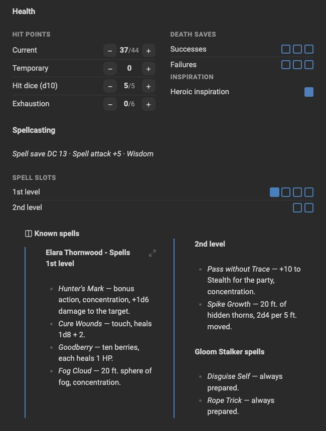
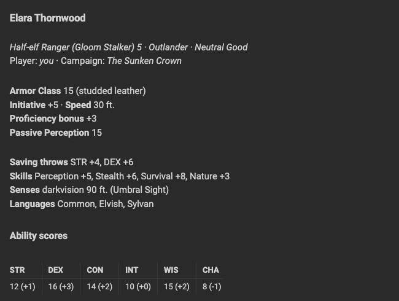
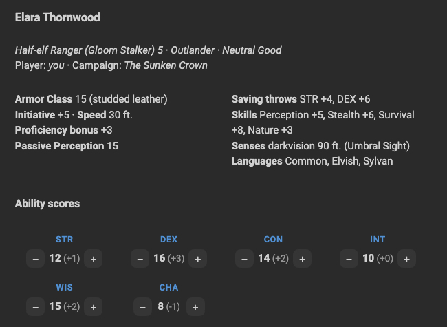
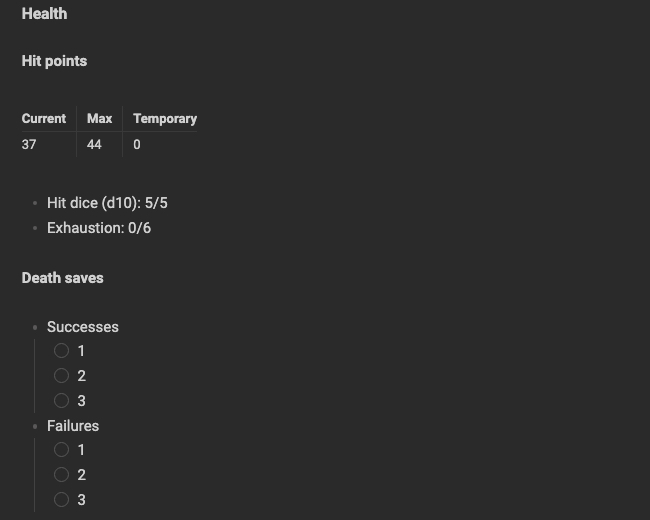
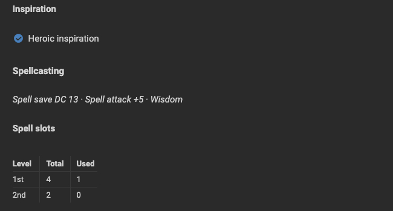
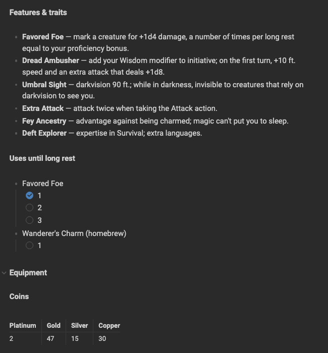
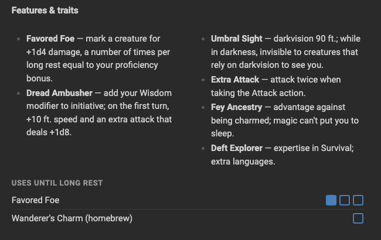
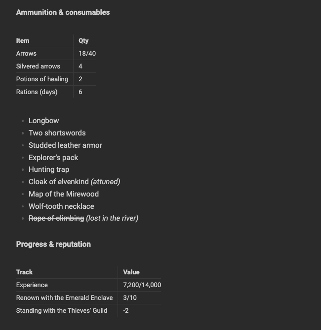
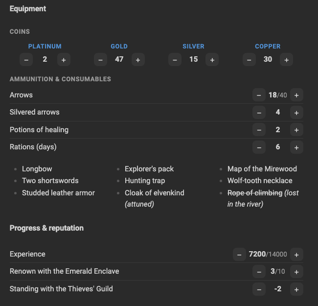

# TTRPG Sheet Kit

*[Read in English](README.md)*

Tieni la scheda del tuo personaggio di gioco di ruolo in Obsidian e aggiornala con un clic.

TTRPG Sheet Kit trasforma piccoli blocchi YAML in **contatori con bottoni −/+** e
**tracce di caselle**, e aggiunge un **callout a colonne** per impaginare il resto della scheda.
Ogni clic riscrive il nuovo valore nella nota come testo semplice: la scheda resta
leggibile, ricercabile e sincronizzata come qualsiasi altra nota.

Funziona con qualsiasi sistema: D&D, Fate, Pathfinder, Blades in the Dark o il tuo homebrew.

<p align="center">
  
</p>

*Più sotto trovi il [confronto prima e dopo](#prima-e-dopo).*

## Funzionalità

- **Contatori** con bottoni −/+, minimo e massimo facoltativi, passo personalizzato (Shift+clic = ×5).
- **Tracce di caselle** per stress, slot incantesimo, usi giornalieri, slot dello zaino.
- **Layout verticale o orizzontale**, con modificatore D&D facoltativo (14 → +2).
- **Gruppi**: più gruppi con titolo nello stesso blocco.
- **Callout a colonne** per mettere elenchi e testo (anche note incorporate) su due o tre colonne.
- **Comandi di inserimento**: scegli un blocco pronto dalla palette dei comandi o dal clic destro, senza ricordare la sintassi.
- Funziona in **modalità Lettura e Live Preview**, su desktop e mobile.
- Cambia solo il numero modificato: formattazione e commenti dello YAML restano intatti.
- Interfaccia in italiano e inglese (segue la lingua di Obsidian).

## Installazione

**Dai plugin della community** (dopo la pubblicazione): Impostazioni → Plugin della community → Sfoglia → cerca "TTRPG Sheet Kit".

**Con BRAT**: aggiungi `progressify/ttrpg-sheet-kit` nel plugin [BRAT](https://github.com/TfTHacker/obsidian42-brat).

**A mano**: scarica `main.js`, `manifest.json` e `styles.css` dall'[ultima release](https://github.com/progressify/ttrpg-sheet-kit/releases)
in `<vault>/.obsidian/plugins/ttrpg-sheet-kit/`, poi attiva il plugin in
Impostazioni → Plugin della community.

## Per iniziare

1. Apri una nota ed esegui **TTRPG Sheet Kit: Inserisci blocco…** dalla palette dei comandi (Cmd/Ctrl+P),
   oppure fai clic destro nell'editor e scegli **Inserisci blocco TTRPG Sheet Kit…**.
2. Scegli un modello, per esempio *Caratteristiche D&D*.
3. Clicca −/+ per cambiare i valori.

Ogni modello ha anche il suo comando (`TTRPG Sheet Kit: Inserisci: …`), a cui puoi assegnare
una scorciatoia in Impostazioni → Tasti di scelta rapida.

## Contatori

### Forma breve

````markdown
```ttrpgsk-counters
oro: 7
frecce: 18
punti_fato: 2/3        # valore/massimo
```
````

### Forma estesa

````markdown
```ttrpgsk-counters
platino_nero: { label: "Platino (impero nero)", value: 6 }
pf:
  label: Punti ferita
  value: 24
  max: 30
stress: { type: track, max: 3, value: 1 }
```
````

| Campo   | Significato                                                | Default   |
| ------- | ---------------------------------------------------------- | --------- |
| `label` | nome mostrato (anche `name`)                               | la chiave |
| `value` | valore attuale, anche nella forma `2/3`                    | 0         |
| `max`   | massimo                                                    | nessuno   |
| `min`   | minimo (`null` = nessun minimo)                            | 0         |
| `step`  | di quanto cambia a ogni clic (Shift+clic = × 5)            | 1         |
| `type`  | `number`, oppure `track` per le caselle (serve `max`)      | `number`  |
| `mod`   | mostra il modificatore D&D, es. 14 → (+2)                  | `false`   |

In una traccia, cliccare una casella riempie la traccia fino a quella; cliccare l'ultima piena la svuota.

### Opzioni del blocco

| Opzione  | Valori                                                        |
| -------- | ------------------------------------------------------------- |
| `label`  | titolo del blocco                                             |
| `layout` | `vertical` (default) oppure `horizontal` (anche `verticale`/`orizzontale`) |
| `mod`    | `true` per mostrare il modificatore su tutti i contatori      |

`label`, `name`, `layout` e `mod` sono riservate: non usarle come nomi di contatori.

````markdown
```ttrpgsk-counters
layout: horizontal
mod: true
FOR: 10
DES: 14
COS: 12
INT: 8
SAG: 13
CAR: 16
```
````

Nel layout orizzontale, se la pagina è stretta i contatori vanno a capo.

### Più gruppi in un blocco

Ogni gruppo ha le sue opzioni e i contatori sotto `items:`.

````markdown
```ttrpgsk-counters
soldi:
  label: Soldi
  layout: horizontal
  items:
    platino: 0
    oro: 12
    argento: 30
stats:
  label: Statistiche
  mod: true
  items:
    for: { label: FOR, value: 10 }
    int:
      label: INTELLIGENZA
      value: 13
```
````

## Callout a colonne

Metti qualsiasi Markdown (elenchi, testo, link, blocchi `ttrpgsk-counters`) su più colonne:

```markdown
> [!ttrpgsk-columns] Incantesimi
> - Palla di fuoco
> - Dardo incantato
> - Scudo
> - Invisibilità
```

- `> [!ttrpgsk-columns|3]` tre colonne
- `> [!ttrpgsk-columns|plain]` senza bordo né titolo
- `> [!ttrpgsk-columns|3 plain]` entrambe le cose

Funziona anche con una nota incorporata, il cui contenuto viene diviso tra le colonne:

```markdown
> [!ttrpgsk-columns|plain]
> ![[incantesimi]]
```

Sul telefono il callout torna a una colonna sola.

## Scheda di esempio

La cartella [`examples`](examples) contiene un personaggio completo di D&D 5e,
[Elara Thornwood](examples/Elara%20Thornwood.md) (in inglese), che usa tutte le funzionalità
del plugin: caratteristiche con modificatore, punti ferita con massimo, tiri salvezza contro
la morte e slot incantesimo come tracce, monete e munizioni raggruppate, valori negativi e un
elenco di incantesimi incorporato su colonne. Copiala nel tuo vault insieme a
[Elara Thornwood - Spells](examples/Elara%20Thornwood%20-%20Spells.md) per provarla.

La stessa scheda scritta in Markdown semplice, senza il plugin, è in
[Elara Thornwood (without plugin)](examples/Elara%20Thornwood%20(without%20plugin).md).

### Prima e dopo

Stesso personaggio, stessi dati, stesso tema e stessa larghezza della finestra.

<table>
  <tr>
    <th width="50%">Markdown semplice</th>
    <th width="50%">Con TTRPG Sheet Kit</th>
  </tr>
  <tr>
    <td valign="top"></td>
    <td valign="top"></td>
  </tr>
  <tr>
    <td valign="top"><br></td>
    <td valign="top"></td>
  </tr>
  <tr>
    <td valign="top"></td>
    <td valign="top"></td>
  </tr>
  <tr>
    <td valign="top"></td>
    <td valign="top"></td>
  </tr>
</table>

## Generare schede con l'AI

[`llms.txt`](llms.txt) è un riferimento compatto scritto per gli assistenti AI (ChatGPT, Claude, …).
Incollalo, o incolla il suo link, in una conversazione e chiedi una scheda: l'assistente scriverà
Markdown che funziona con TTRPG Sheet Kit. Puoi chiedere la scheda anche in italiano.

## Buono a sapersi

- I valori stanno dentro il blocco `ttrpgsk-counters` della nota, non in un database: puoi sempre modificarli a mano.
- Per modificare lo YAML di un blocco in Live Preview, passa il mouse sopra il blocco e clicca il bottone `</>` in alto a destra.
- Se due dispositivi modificano lo stesso contatore nello stesso momento, il servizio di sincronizzazione lo gestisce come qualsiasi altra modifica al testo.

## Feedback e nuove funzionalità

Mi farebbe piacere sapere come usi TTRPG Sheet Kit al tuo tavolo.

- **Ti manca una funzionalità?** Qualcosa per il tuo sistema di gioco, un nuovo layout, un nuovo tipo di tracciamento?
  [Apri una richiesta](https://github.com/progressify/ttrpg-sheet-kit/issues/new?template=feature_request.yml).
- **Hai trovato un bug?** [Apri una segnalazione](https://github.com/progressify/ttrpg-sheet-kit/issues/new?template=bug_report.yml)
  con una copia del blocco che non funziona e, se puoi, uno screenshot.
- **Vuoi solo dire cosa ne pensi** delle funzionalità attuali, nel bene o nel male? [Lascia un feedback](https://github.com/progressify/ttrpg-sheet-kit/issues/new?template=feedback.yml):
  ogni commento aiuta a decidere cosa migliorare. Puoi scrivere anche in italiano.

## Sviluppo

Il plugin è JavaScript semplice, senza passaggio di build.

```bash
npm test
```

Per pubblicare una versione: aggiorna `version` in `manifest.json`, `package.json` e `versions.json`,
poi fai il push di un tag con la stessa versione (es. `0.2.0`, senza `v`). Il workflow di GitHub
esegue i test e crea una release in bozza con `main.js`, `manifest.json` e `styles.css`.

## Licenza

[MIT](LICENSE) © Progressify
