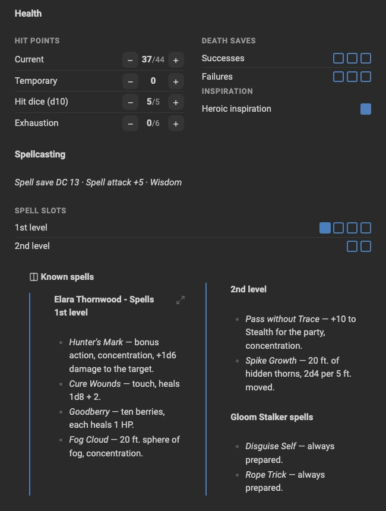
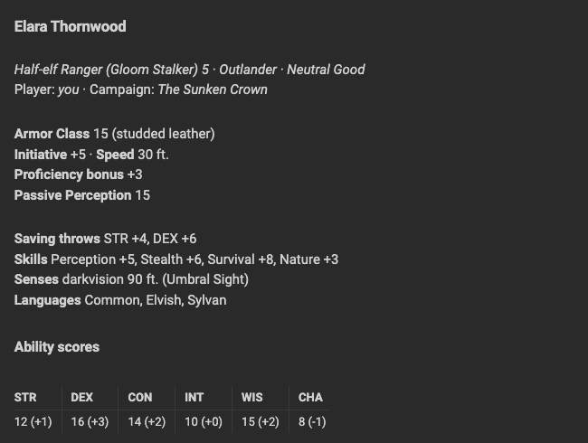
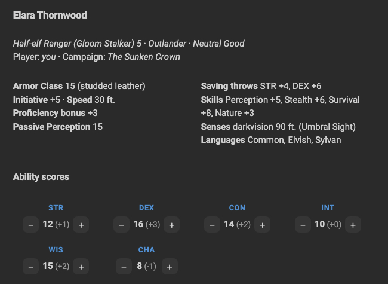
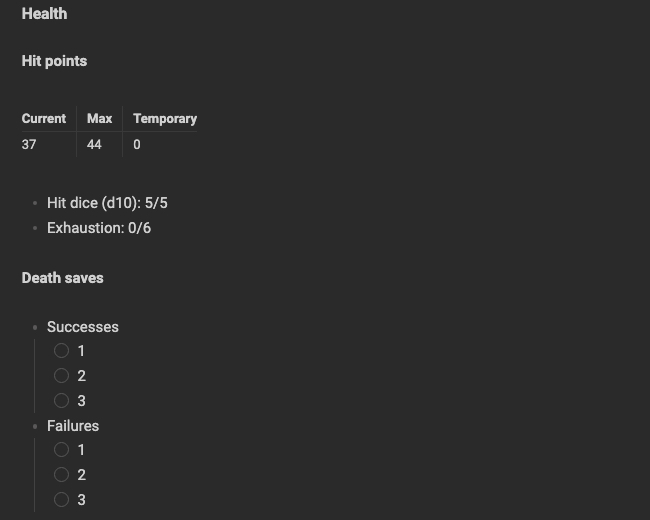
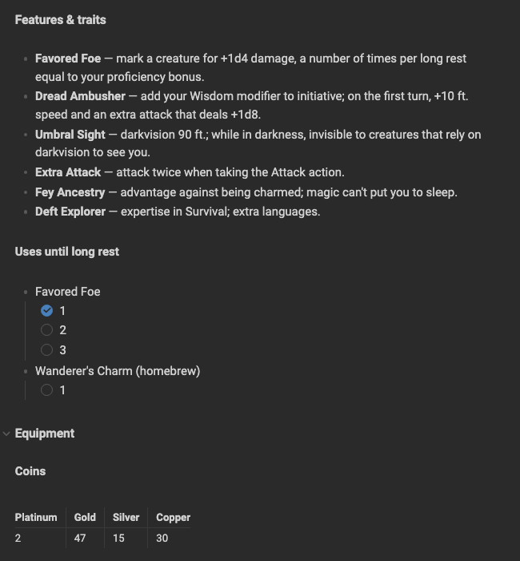
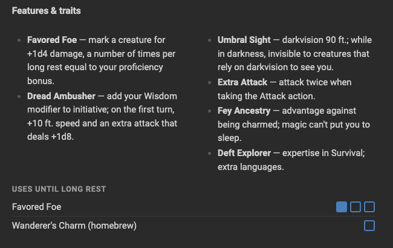
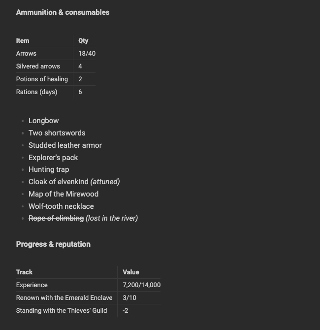
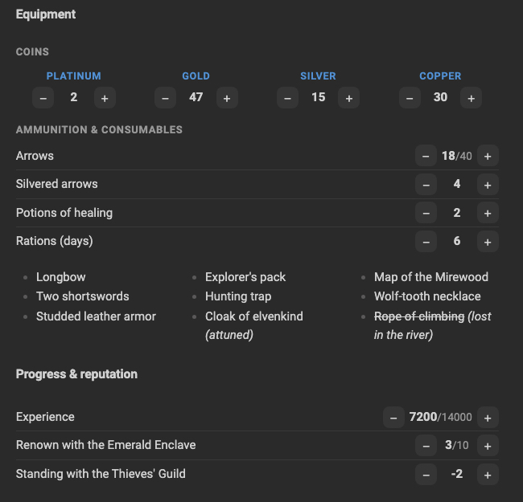

# TTRPG Sheet Kit

*[Leggi in italiano](README.it.md)*

Keep your tabletop RPG character sheet in Obsidian and update it with a click.

TTRPG Sheet Kit turns small YAML blocks into **counters with −/+ buttons** and
**checkbox tracks**, and adds a **columns callout** to lay out the rest of the sheet.
Every click writes the new value back to the note as plain text, so your sheet
stays readable, searchable and synced like any other note.

It is system-agnostic: D&D, Fate, Pathfinder, Blades in the Dark, or your own homebrew.

<p align="center">
  
</p>

*See the [before and after comparison](#before-and-after) below.*

## Features

- **Counters** with −/+ buttons, optional minimum and maximum, custom step (Shift+click = ×5).
- **Checkbox tracks** for stress, spell slots, daily uses, inventory slots.
- **Vertical or horizontal layout**, with optional D&D ability modifiers (14 → +2).
- **Groups**: several titled groups in one block.
- **Columns callout** to put lists and text (even embedded notes) in two or three columns.
- **Insert commands**: pick a ready-made block from the command palette or the right-click menu, no syntax to remember.
- Works in **Reading view and Live Preview**, on desktop and mobile.
- Changes only the number that changed: your formatting and YAML comments are kept.
- Interface in English and Italian (follows Obsidian's language).

## Installation

**From Community plugins** (once published): Settings → Community plugins → Browse → search "TTRPG Sheet Kit".

**With BRAT**: add `progressify/ttrpg-sheet-kit` in the [BRAT](https://github.com/TfTHacker/obsidian42-brat) plugin.

**Manually**: download `main.js`, `manifest.json` and `styles.css` from the
[latest release](https://github.com/progressify/ttrpg-sheet-kit/releases) into
`<vault>/.obsidian/plugins/ttrpg-sheet-kit/`, then enable the plugin in
Settings → Community plugins.

## Quick start

1. Open a note and run **TTRPG Sheet Kit: Insert block…** from the command palette (Cmd/Ctrl+P),
   or right-click in the editor and choose **Insert TTRPG Sheet Kit block…**.
2. Pick a template, for example *D&D ability scores*.
3. Click −/+ to change the values.

Every template also has its own command (`TTRPG Sheet Kit: Insert: …`) that you can bind
to a hotkey in Settings → Hotkeys.

## Counters

### Short form

````markdown
```ttrpgsk-counters
gold: 7
arrows: 18
fate_points: 2/3        # value/maximum
```
````

### Long form

````markdown
```ttrpgsk-counters
platinum_old: { label: "Platinum (old empire)", value: 6 }
hp:
  label: Hit points
  value: 24
  max: 30
stress: { type: track, max: 3, value: 1 }
```
````

| Field   | Meaning                                                  | Default   |
| ------- | -------------------------------------------------------- | --------- |
| `label` | displayed name (`name` works too)                        | the key   |
| `value` | current value, also as `2/3`                             | 0         |
| `max`   | maximum                                                  | none      |
| `min`   | minimum (`null` = no minimum)                            | 0         |
| `step`  | change per click (Shift+click = × 5)                     | 1         |
| `type`  | `number`, or `track` for checkboxes (requires `max`)     | `number`  |
| `mod`   | show the D&D modifier, e.g. 14 → (+2)                    | `false`   |

In a track, clicking a box fills the track up to that box; clicking the last filled box empties it.

### Block options

| Option   | Values                                        |
| -------- | --------------------------------------------- |
| `label`  | block title                                   |
| `layout` | `vertical` (default) or `horizontal`          |
| `mod`    | `true` to show the modifier on every counter  |

`label`, `name`, `layout` and `mod` are reserved: don't use them as counter names.

````markdown
```ttrpgsk-counters
layout: horizontal
mod: true
STR: 10
DEX: 14
CON: 12
INT: 8
WIS: 13
CHA: 16
```
````

In the horizontal layout, counters wrap onto a new row when the page is too narrow.

### Several groups in one block

Each group has its own options and its counters under `items:`.

````markdown
```ttrpgsk-counters
coins:
  label: Coins
  layout: horizontal
  items:
    platinum: 0
    gold: 12
    silver: 30
abilities:
  label: Abilities
  mod: true
  items:
    str: { label: STR, value: 10 }
    int:
      label: INTELLIGENCE
      value: 13
```
````

## Columns callout

Put any Markdown (lists, text, links, `ttrpgsk-counters` blocks) in columns:

```markdown
> [!ttrpgsk-columns] Spells
> - Fireball
> - Magic missile
> - Shield
> - Invisibility
```

- `> [!ttrpgsk-columns|3]` three columns
- `> [!ttrpgsk-columns|plain]` no border or title
- `> [!ttrpgsk-columns|3 plain]` both

It also works with an embedded note, whose content is split across the columns:

```markdown
> [!ttrpgsk-columns|plain]
> ![[spells]]
```

On phones the callout falls back to a single column.

## Example sheet

The [`examples`](examples) folder contains a complete D&D 5e character,
[Elara Thornwood](examples/Elara%20Thornwood.md), that uses every feature of the plugin:
ability scores with modifiers, hit points with a maximum, death saves and spell slots as
tracks, grouped coins and ammunition, negative values, and an embedded spell list in columns.
Copy it into your vault together with
[Elara Thornwood - Spells](examples/Elara%20Thornwood%20-%20Spells.md) to try it.

The same sheet written in plain Markdown, without the plugin, is in
[Elara Thornwood (without plugin)](examples/Elara%20Thornwood%20(without%20plugin).md).

### Before and after

Same character, same data, same theme and window width.

<table>
  <tr>
    <th width="50%">Plain Markdown</th>
    <th width="50%">With TTRPG Sheet Kit</th>
  </tr>
  <tr>
    <td valign="top"></td>
    <td valign="top"></td>
  </tr>
  <tr>
    <td valign="top"><br></td>
    <td valign="top"></td>
  </tr>
  <tr>
    <td valign="top"></td>
    <td valign="top"></td>
  </tr>
  <tr>
    <td valign="top"></td>
    <td valign="top"></td>
  </tr>
</table>

## Generate sheets with AI

[`llms.txt`](llms.txt) is a compact reference written for AI assistants (ChatGPT, Claude, …).
Paste it, or its link, into a conversation and ask for a character sheet: the assistant will
write Markdown that works with TTRPG Sheet Kit.

## Good to know

- Values live inside the `ttrpgsk-counters` block in your note, not in a database: you can edit them by hand at any time.
- To edit a block's YAML in Live Preview, hover it and click the `</>` button in the top-right corner.
- If two devices edit the same counter at the same time, your sync service resolves it like any other text change.

## Feedback and feature requests

I'd love to hear how you use TTRPG Sheet Kit at your table.

- **Missing a feature?** Need something for your game system, a new layout, a new kind of tracker?
  [Open a feature request](https://github.com/progressify/ttrpg-sheet-kit/issues/new?template=feature_request.yml).
- **Found a bug?** [Open an issue](https://github.com/progressify/ttrpg-sheet-kit/issues/new?template=bug_report.yml)
  with a copy of the block that misbehaves and, if you can, a screenshot.
- **Just want to share feedback** on the current features, good or bad? [Leave some feedback](https://github.com/progressify/ttrpg-sheet-kit/issues/new?template=feedback.yml):
  every comment helps decide what to improve next.

## Development

The plugin is plain JavaScript with no build step. See [CONTRIBUTING.md](CONTRIBUTING.md) for setup, conventions and pull requests.

```bash
npm test
```

To release: bump `version` in `manifest.json`, `package.json` and `versions.json`,
then push a tag with the same version (e.g. `0.2.0`, no `v`). The GitHub workflow
runs the tests and creates a draft release with `main.js`, `manifest.json` and `styles.css`.

## License

[MIT](LICENSE) © Progressify
